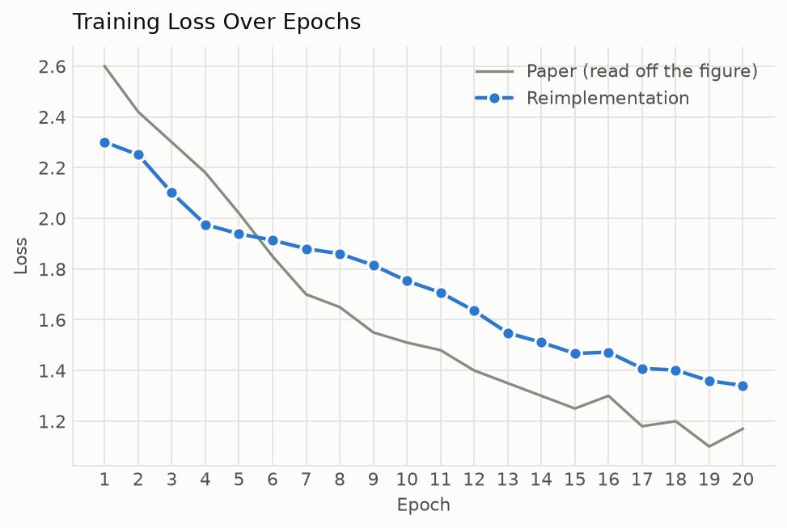
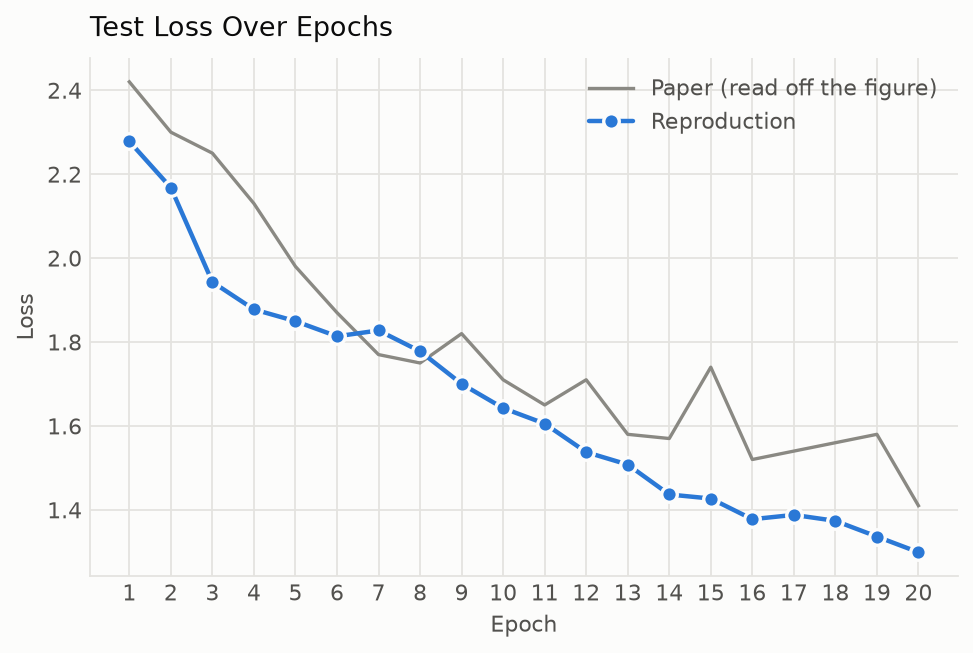
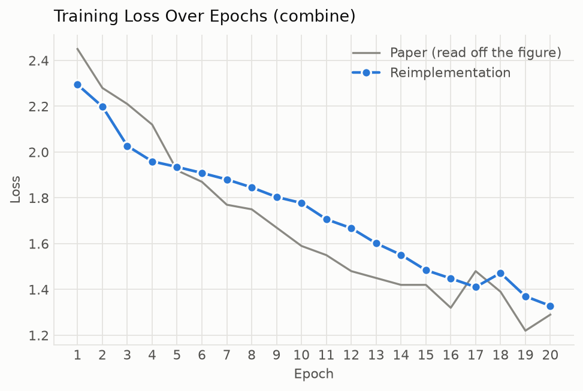
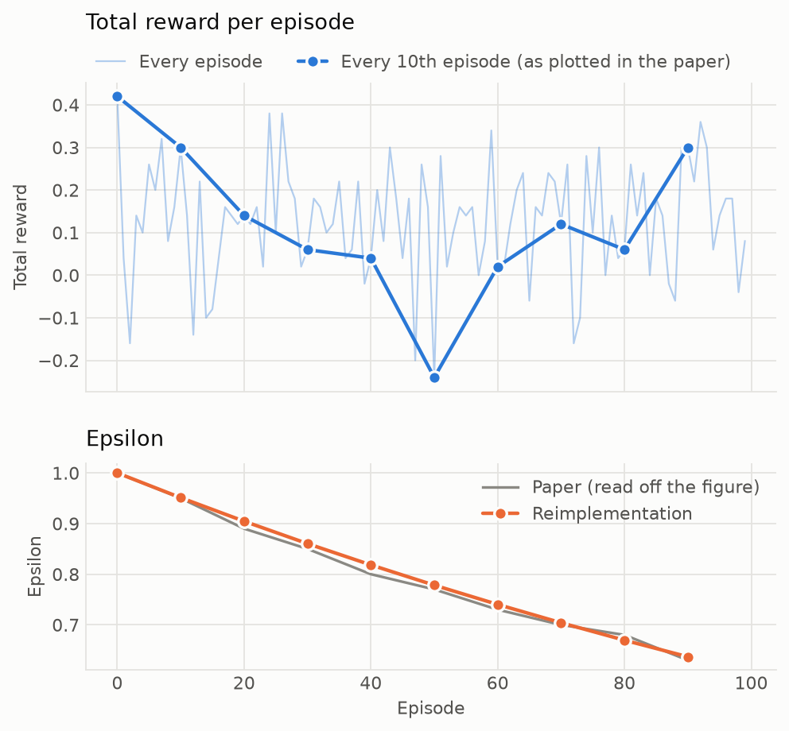
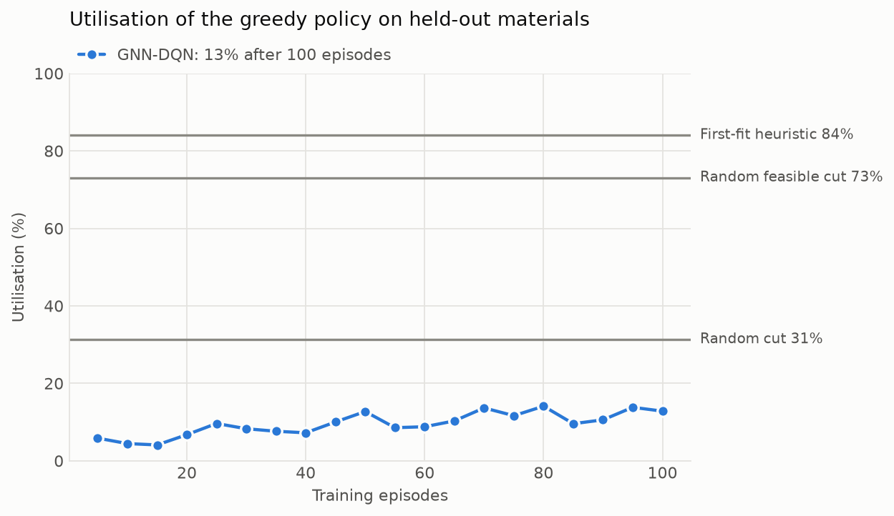
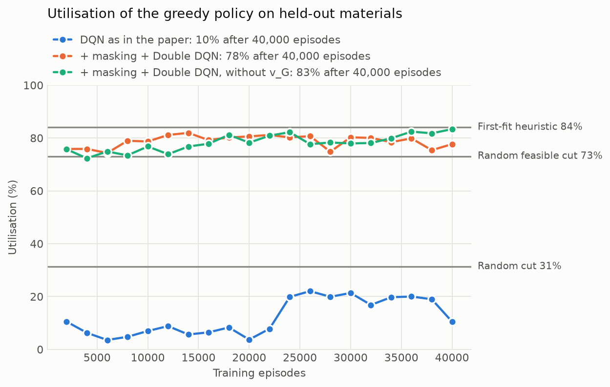

# 论文复现：GNN + DQN 求解下料问题

复现对象：Linxuan Chen, *Sustainable Material Cutting Optimization Using Deep Q-Networks: A Reinforcement Learning Approach for Resource Efficiency*, ITM Web of Conferences **73**, 01002 (2025)（即本目录下的 `itmconf_iwadi2024_01002.pdf`）。

## 结论

| 论文图 | 论文（从图上目测读数） | 本复现（seed 0） | 5 个随机种子 | 是否复现 |
|---|---|---|---|---|
| Fig. 3 GNN 训练 loss | 2.60 → 1.17 | 2.30 → 1.34 | 末值 1.39 ± 0.06 | 趋势一致，末值略高 |
| Fig. 4 GNN 测试 loss | 2.42 → 1.41 | 2.28 → 1.30 | 末值 1.40 ± 0.08 | 一致 |
| Fig. 5 联合 loss | 2.45 → 1.29 | 2.31 → 1.34 | 末值 1.39 ± 0.06 | 一致 |
| Fig. 6 ε | 1.00 → 0.63（第 90 回合） | 1.00 → 0.637 | 与种子无关 | 一致（每回合 ×0.995） |
| Fig. 6 总回报 | 397–415，无明显趋势 | −0.16–0.42，无明显趋势 | 前 50 回合均值 0.14，后 50 回合 0.12 | 定性一致，数值不可比（论文没给奖励定义） |

论文里的四张图在定性上都能复现。但有两点需要知道：

1. **按论文的训练量（100 回合，ε 最低只到 0.61），DQN 还没有学到切割策略。** 训练结束后用贪心策略测试，材料利用率只有 10%（5 个种子 13 ± 3%），低于纯随机下刀的 31%。论文 Fig. 6 的回报曲线同样没有上升趋势，所以这一点和论文的数据并不矛盾，但它不支持论文正文里“收敛到最优策略”的说法。
2. **训练更久也不行，除非改算法。** 把同一个 DQN 训练到 4 万回合，Q 值严重高估（最大 Q 均值涨到 18，而回报上限是 1），最终利用率 3%。加上“无效动作屏蔽 + Double DQN”这两个论文里没有的改动后，才学到 79%，高于随机可行下刀的 73%，仍低于 first-fit 启发式的 84%。

以上第 1、2 点都依赖于我自己设计的切割环境（论文没有给出环境定义，见下文“论文没写、我做的假设”）。

## 运行

```bash
uv venv --python 3.12 .venv
```

```bash
uv pip install --python .venv/bin/python -e .
```

数据集（彩色 200×200 版 KTH-TIPS，约 68 MB）：

```bash
mkdir -p data/kth_tips && curl -L -o data/kth_tips/kth_tips_col_200x200.tar https://www.csc.kth.se/cvap/databases/kth-tips/kth_tips_col_200x200.tar && tar -xf data/kth_tips/kth_tips_col_200x200.tar -C data/kth_tips
```

论文协议（Fig. 3–6，约 20 秒，CPU 即可）：

```bash
.venv/bin/python -m csp_gnn_dqn.reproduce
```

加上两个 4 万回合的扩展实验（再多约 9 分钟）：

```bash
.venv/bin/python -m csp_gnn_dqn.reproduce --extended
```

换随机种子：加 `--seed 1 --out-dir results/seed_1`。两个阶段也可以单独跑：`python -m csp_gnn_dqn.train_gnn`、`python -m csp_gnn_dqn.train_combined`（`--help` 查看全部超参）。相同种子下结果是确定性的。

## 代码结构

| 文件 | 内容 | 论文章节 |
|---|---|---|
| `src/csp_gnn_dqn/data.py` | KTH-TIPS 读取、灰度化、裁剪缩放到 128×128、LBP 直方图、建图 | 2.1 |
| `src/csp_gnn_dqn/gnn.py` | 3 层 GCN + Jumping Knowledge + 全局平均池化 + 全连接分类 | 2.2，式 (1)(2) |
| `src/csp_gnn_dqn/env.py` | 二维下料仿真环境、动作空间、first-fit 基线 | 2.3，式 (3)(4) |
| `src/csp_gnn_dqn/dqn.py` | Q 网络、经验回放、TD 损失 | 2.3，式 (5)(6) |
| `src/csp_gnn_dqn/train_gnn.py` | 阶段一：GNN 纹理分类 | Fig. 3、Fig. 4 |
| `src/csp_gnn_dqn/train_combined.py` | 阶段二：GNN + DQN 联合训练与策略评估 | Fig. 5、Fig. 6 |
| `src/csp_gnn_dqn/plots.py` | 画图（灰线是论文曲线的目测读数，仅供对比） | — |
| `src/csp_gnn_dqn/reproduce.py` | 一键运行入口 | — |

## 论文明确规定、照做的部分

- 数据：KTH-TIPS，10 类 × 81 张 = 810 张；转灰度，裁成正方形后缩放到 128×128；用 LBP 直方图作输入特征。
- GNN：3 层 GCN（ReLU，式 (1) 的对称归一化带自环邻接矩阵）；Jumping Knowledge 把第 0–3 层表示拼接后接线性变换（式 (2)）；全局平均池化得到图向量 v_G；全连接层分类。
- DQN：状态 s = [v_G, f_C]；|A| = 100，动作为 (x, y, θ)，θ ∈ {0°, 90°}；MLP 隐藏层 128、64（ReLU）；回放池 10 000；batch 32；γ = 0.99；目标网络每 1000 步同步；平方 TD 误差（式 (6)）。
- 训练量：GNN 20 个 epoch；联合训练 20 个 epoch、100 个回合。

## 论文没写、我做的假设

这些地方论文没有给出细节，下面是本复现的选择。如果原始实现不同，改对应位置即可。

| 项目 | 我的选择 | 依据 |
|---|---|---|
| 图的节点和边 | 把图像切成 8×8 个 16×16 的 patch，每个 patch 一个节点（64 个），4 邻域连边 | 论文说“图像的高和宽表示为图节点”；直方图只能定义在区域上 |
| 节点特征 | patch 内的 uniform LBP（P=8, R=1）10 维直方图 | 论文说 LBP 直方图作输入特征。再拼上展平的灰度像素（`--features lbp+gray`）会明显变差，见下表 |
| 训练/测试划分 | 每类分层 80/20（650/160） | 论文没写 |
| 隐藏维度、优化器 | 64 维；Adam，lr 1e-3，batch 32 | 论文没写，取常用默认值，没有为贴合论文曲线调参 |
| ε 调度 | 初值 1.0，每回合 ×0.995 | 由 Fig. 6 的 ε 曲线反推，吻合 |
| 板材与订单 | 10×5 格的板（2:1），10×5×2 正好是 100 个动作；把整板随机“一刀切”分成若干矩形作为订单，逐件随机顺序给出，所以事后最优利用率是 100% | 论文没给环境 |
| 奖励 | 放置成功得“该件面积 / 板面积”，所以一回合的总回报就是利用率；放不下扣 0.02（一格）并丢弃该件 | 论文没给奖励，所以 Fig. 6 的纵轴数值无法对齐 |
| f_C | 剩余面积、已切件数、当前件的宽高，再加 50 维占用图 | 前三项是论文列出的；不加占用图智能体看不到板上哪里空着 |
| 材料如何影响切割 | 灯芯绒、棉、亚麻三类有纹理方向的织物不允许旋转（θ=90° 无效） | 论文说决策依赖材料特性但没说怎么依赖；可用 `--no-grain-constraint` 关掉 |
| “联合 loss” | 每个 epoch：GNN 过一遍训练集（交叉熵）→ 刷新所有材料的 v_G → 跑 5 个回合，每步做一次 DQN 更新；联合 loss = 交叉熵 + TD 损失；TD 梯度不回传到 GNN | 论文说 DRL“使用 GNN 生成的数据”；Fig. 5 从 2.45 起步，说明是从头训练 |

## 结果

### 阶段一：GNN（Fig. 3、Fig. 4）




训练 loss 2.30 → 1.34，测试 loss 2.28 → 1.30，测试准确率 56%（5 个种子 54 ± 6%；论文没有报告准确率）。起点是 ln 10 ≈ 2.30，即 10 类均匀猜测；论文起点 2.6 高于这个值，应是初始化不同。20 个 epoch 时模型还远没有收敛。

节点特征的敏感性（lr 1e-3，种子 0 和 1，第 20 个 epoch 的 loss）：

| 节点特征 | 训练 loss | 测试 loss |
|---|---|---|
| LBP 直方图（默认） | 1.33–1.34 | 1.30–1.49 |
| LBP 直方图 + 展平灰度像素 | 1.66–1.74 | 1.69–1.70 |
| 仅展平灰度像素 | 1.71–1.81 | 1.67–1.76 |

默认值是看过这张表之后定的：三种读法里它既最贴近论文的文字，也最接近论文的曲线。

### 阶段二：GNN + DQN（Fig. 5、Fig. 6）




- 联合 loss 2.31 → 1.34。其中 TD 损失只有约 0.002，所以这条曲线基本就是 GNN 的交叉熵；同一个种子下它和 Fig. 3 的 GNN 训练过程完全相同。
- ε 曲线和论文重合。为避免双纵轴，回报和 ε 分成上下两栏画。
- 回报在 −0.16 到 0.42 之间波动，没有趋势，和论文 Fig. 6 一样。

训练结束后在测试集材料上各跑 200 个回合：

| 策略 | 材料利用率 | 无效下刀比例 |
|---|---|---|
| GNN-DQN 贪心（100 回合训练后） | 10% | 87% |
| 随机下刀 | 31% | 49% |
| 随机可行下刀（只在放得下的位置里随机） | 73% | 9% |
| first-fit 启发式 | 84% | 6% |



### 扩展实验（论文之外）：训练 4 万回合



| 设置 | 最终利用率 | 现象 |
|---|---|---|
| 论文原样的 DQN | 3% | 最大 Q 均值在第 4 个 epoch 涨到 18（回报上限为 1），TD 损失达到 34，之后回落，但策略已经塌到几乎每刀都无效（94%） |
| + 无效动作屏蔽 + Double DQN | 79% | Q 值稳定在 0.35 左右；利用率从 75% 升到 79%，各 epoch 在 73–80% 之间波动 |

排查时我还单独试过几种变体（临时脚本，没有放进代码；状态只用 f_C、不含 v_G）：只加 Double DQN 时 Q 值不再发散，但利用率仍在 25% 以下；把无效下刀改成直接结束回合、或把惩罚加大到 0.2，利用率也都不超过 30%，即都没学会找可行位置。我的判断是 128-64 的 MLP 要从 50 维占用图里为 100 个动作各自学会“这里放不放得下”，样本效率很低。

## 没有验证的部分

- 论文称 GNN 的结构信息提升了 DRL 的决策，但论文里没有消融实验，这里也没有做（去掉 v_G 的对照）。在我的环境里材料只通过“能否旋转”影响切割，开了动作屏蔽后这一约束已经由屏蔽处理，v_G 的作用很有限。
- 原始代码的图构建方式、环境和奖励都不清楚，所以 loss 的绝对值和回报的量纲只能做定性对比。
- 表中论文一栏的数字是从论文图上目测读出来的，有 ±0.03 左右的误差。

## 许可证

代码采用 [MIT 许可证](LICENSE)。论文 PDF 不在此列，它按原出版方的 CC BY 4.0 许可发布。
